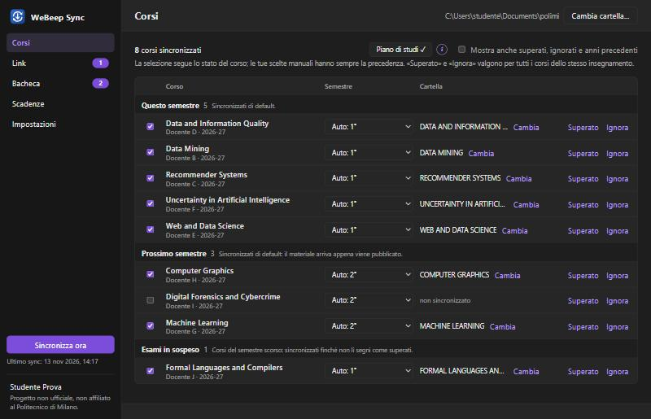
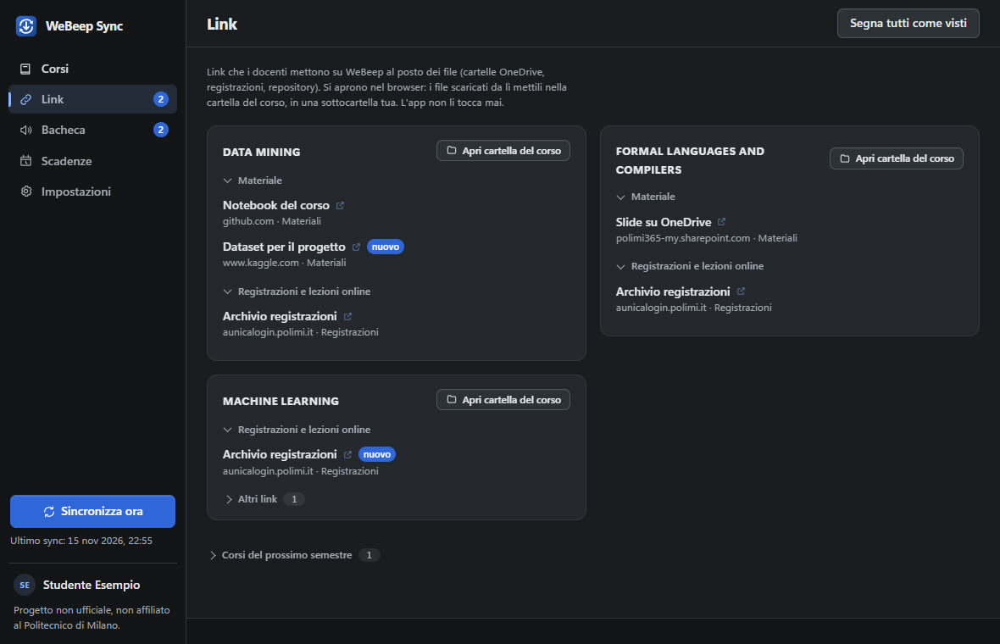
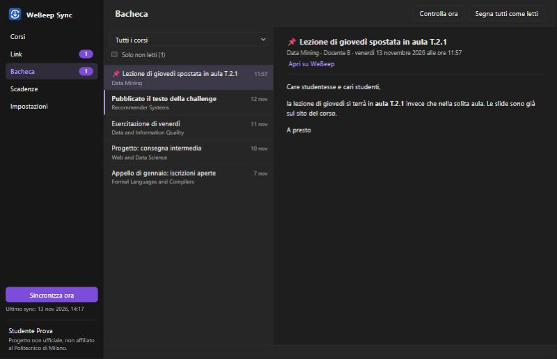

# WeBeep Sync

**[Read in English](README.md)**

App desktop **non ufficiale** che tiene una copia locale del materiale dei corsi di
[WeBeep](https://webeep.polimi.it), il Moodle del Politecnico di Milano.

> Progetto non ufficiale, non affiliato al Politecnico di Milano.

## Cosa fa

- **Scarica il materiale dei tuoi corsi**, cartelle comprese: cartelle annidate, file dentro le
  pagine, allegati delle consegne, ZIP salvati con l'estensione giusta.
- **Non sovrascrive mai il tuo lavoro.** Se annoti delle slide e il docente le aggiorna, la nuova
  versione viene salvata accanto alla tua (`… (WeBeep aggiornato AAAA-MM-GG).pdf`). I file rimossi
  dal docente vengono solo segnalati, mai cancellati.
- **Corsi dell'anno accademico in corso, divisi per semestre:** questo semestre, prossimo
  semestre, esami in sospeso. Importando il piano di studi ogni corso prende da solo il semestre
  giusto.
- **Scheda Link:** cartelle OneDrive, registrazioni delle lezioni e repository che i docenti
  pubblicano al posto dei file, raggruppati per corso, con i nuovi in evidenza.
- **Bacheca degli avvisi e scadenze** (consegne e quiz dei prossimi 14 giorni), con notifiche di
  sistema.
- **Corsi superati:** segni un corso come superato e l'app propone di spostare i file nel
  Cestino (solo quelli che ha scaricato lei, mai quelli che hai modificato o aggiunto tu).
- **Riusa la cartella di WeBeep Sync v1:** i file già presenti e identici non vengono riscaricati.
- Interfaccia in **italiano e inglese**.

L'app lavora solo mentre la finestra è aperta: chiudendola si chiude tutto.

## Installazione (Windows)

1. Scarica `WeBeep Sync_x.y.z_x64-setup.exe` dall'[ultima release](https://github.com/KeyElleLF/webeep-sync-v2/releases/latest).
2. Avvialo. Non servono permessi di amministratore.
3. Windows potrebbe mostrare **«Windows ha protetto il PC»** (SmartScreen): succede con tutte le
   app non firmate con un certificato a pagamento. Clicca **«Ulteriori informazioni» → «Esegui
   comunque»**.
4. Apri **WeBeep Sync** dal menu Start.

Disinstallando l'app, i file scaricati restano dove sono. Le versioni per macOS e Linux non sono
ancora disponibili.

**Gli aggiornamenti sono automatici** (dalla versione 0.2.0): quando esce una versione nuova
l'app mostra un avviso; «Aggiorna ora» la scarica, ne verifica la firma, la installa e riavvia.
Account, impostazioni e file restano. Hai una versione precedente? Installa una volta a mano la
0.2.0.

## Primo avvio

1. **Accedi a WeBeep** con il tuo account Polimi: si apre la pagina di login ufficiale del
   Politecnico, in una finestra dedicata.
2. **Scegli la cartella** dove salvare i corsi (va bene anche quella di WeBeep Sync v1).
3. Controlla i corsi selezionati e premi **«Sincronizza ora»**.

### Piano di studi (facoltativo, consigliato)

Corsi → **Importa piano di studi** legge dal tuo piano se ogni insegnamento è del 1° o del 2°
semestre. Puoi usare:

- la **ricevuta del piano degli studi** (PDF), se l'hai conservata;
- la pagina **Servizi Online → «Carriera didattica» → «Piano degli studi»** salvata in PDF
  (Ctrl+P → Salva come PDF);
- oppure la **tabella** di quella pagina, selezionata con il mouse, copiata e incollata nell'app.

Si tengono solo codici, nomi e semestri degli insegnamenti: nessun dato personale. Per lasciare
fuori dal PDF i tuoi dati, seleziona prima la tabella e scegli «Solo selezione» nella finestra di
stampa.

## Privacy

- Nessun server e nessuna telemetria: l'app parla solo con `webeep.polimi.it`.
- Accedi sulla pagina ufficiale del Politecnico, in una finestra privata dedicata. L'app non vede
  mai la tua password.
- Il token di accesso è salvato solo nel portachiavi di sistema (Gestione credenziali di Windows)
  e non viene mai scritto nei log.

## Domande frequenti

- **Dove sono i file?** Nella cartella che hai scelto, una sottocartella per corso. La cartella di
  un corso si può rinominare dalla lista dei corsi («Cambia»).
- **Come segno un corso come superato?** Nella lista dei corsi, «Superato». Vale per tutti i corsi
  dello stesso insegnamento, anche degli anni precedenti.
- **L'app può scaricare le cartelle OneDrive?** No: serve il login Microsoft del Politecnico. La
  scheda Link ti dà il link; quello che scarichi mettilo nella cartella del corso («Apri cartella
  del corso»), l'app non lo tocca mai.
- **Dove sono i log?** In `%LOCALAPPDATA%\it.webeepsync.app\logs` (una settimana). Non contengono
  né la password né il token di accesso.

## Segnalare un problema

Nell'app: **Impostazioni → Problemi e segnalazioni → Segnala un problema**. Si apre una
segnalazione su GitHub con versione e sistema già compilati; allega il file di diagnostica
(«Esporta diagnostica»), che nasconde cartelle personali, token ed email. Puoi scrivere in
italiano o in inglese.

## Sviluppo

Vedi [CONTRIBUTING.md](CONTRIBUTING.md) per compilare e testare l'app e
[docs/ARCHITECTURE.md](docs/ARCHITECTURE.md) per come funziona (in inglese). Le note di progetto
complete sono in [CLAUDE.md](CLAUDE.md).

## Crediti

Riscrittura in Rust + Tauri 2 ispirata a [WeBeep Sync](https://github.com/toto04/webeep-sync) di
**toto04** (GPL-3.0), usato come riferimento per capire le API di WeBeep.

## Licenza

[GPL-3.0](LICENSE): puoi usare, studiare, modificare e condividere l'app; le versioni che
condividi devono restare con la stessa licenza e con il loro codice sorgente.
