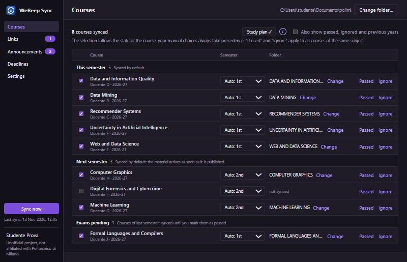
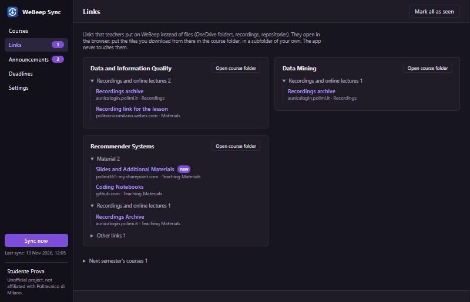
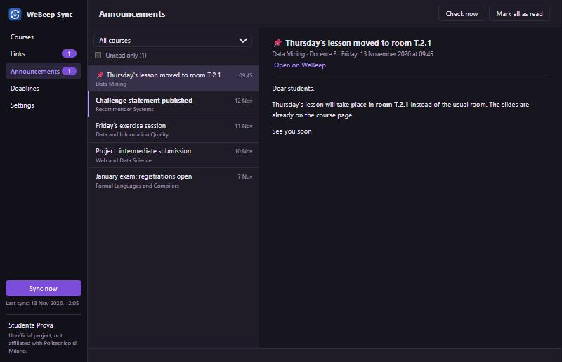

# WeBeep Sync

**[Leggi in italiano](README.it.md)**

An unofficial desktop app that keeps a local copy of the course material of
[WeBeep](https://webeep.polimi.it), the Moodle site of Politecnico di Milano.

> Unofficial project, not affiliated with Politecnico di Milano.

## What it does

- **Downloads the material of your courses**, folders included: nested folders, files inside
  pages, assignment attachments, ZIP files saved with the right extension.
- **Never overwrites your work.** If you annotate some slides and the teacher updates them, the
  new version is saved next to yours (`… (WeBeep aggiornato YYYY-MM-DD).pdf`). Files removed by the
  teacher are only reported, never deleted.
- **Courses of the current academic year, split by semester:** this semester, next semester,
  exams pending. Import your study plan and every course gets the right semester automatically.
- **Links page:** OneDrive folders, lesson recordings and repositories that teachers post instead
  of files, grouped by course, with the new ones highlighted.
- **Announcements and deadlines** (assignments and quizzes of the next 14 days), with system
  notifications.
- **Passed courses:** mark a course as passed and the app offers to move its files to the
  Recycle Bin (only the files it downloaded, never the ones you changed or added).
- **Takes over a WeBeep Sync v1 folder:** files already there and identical are not downloaded
  again.
- **Italian and English** interface.

The app works only while its window is open: closing it quits everything.

## Install (Windows)

1. Download `WeBeep Sync_x.y.z_x64-setup.exe` from the
   [latest release](https://github.com/KeyElleLF/webeep-sync-v2/releases/latest).
2. Run it. No administrator rights needed.
3. Windows may show **"Windows protected your PC"** (SmartScreen): it happens with every app that
   is not signed with a paid certificate. Click **"More info" → "Run anyway"**.
4. Open **WeBeep Sync** from the Start menu.

Uninstalling the app leaves your downloaded files where they are. macOS and Linux builds are not
available yet.

To update, download the new installer and run it over the installed version: your account,
settings and files stay.

## First run

1. **Log in to WeBeep** with your Polimi account: the official Polimi login page opens in a
   dedicated window.
2. **Choose the folder** where courses are saved (the WeBeep Sync v1 folder works too).
3. Check the selected courses and press **"Sync now"**.

### Study plan (optional, recommended)

Courses → **Import study plan** reads from your study plan whether each subject is in the 1st or
2nd semester. You can use:

- the **study plan receipt** (PDF), if you kept it;
- the page **Servizi Online → "Carriera didattica" → "Piano degli studi"** saved as PDF
  (Ctrl+P → Save as PDF);
- or the **table** of that page, selected with the mouse, copied and pasted into the app.

Only codes, names and semesters of the subjects are kept: no personal data. To leave your
personal data out of the PDF, select the table first and choose "Selection only" in the print
dialog.

## Privacy

- No server and no telemetry: the app talks only to `webeep.polimi.it`.
- You log in on the official Polimi page, in a dedicated private window. The app never sees
  your password.
- The access token is stored only in the system keychain (Windows Credential Manager) and is
  never written to the logs.

## FAQ

- **Where are my files?** In the folder you chose, one subfolder per course. A course folder can
  be renamed from the course list ("Change").
- **How do I mark a course as passed?** In the course list, "Passed". It applies to every course
  of the same subject, previous years included.
- **Why are some folder names in Italian when the app is in English?** Folder names come from
  WeBeep, which the app always reads in Italian, so that they never change and your files never
  move.
- **Can the app download OneDrive folders?** No: they need the Polimi Microsoft login. The Links
  page gives you the link; put what you download in the course folder ("Open course folder"),
  the app never touches it.
- **Where are the logs?** In `%LOCALAPPDATA%\it.webeepsync.app\logs` (one week). They contain
  neither your password nor the access token.

## Reporting a problem

In the app: **Settings → Problems and reports → Report a problem**. A GitHub issue opens with
version and system already filled in; attach the diagnostics file ("Export diagnostics"), which
hides personal folders, tokens and emails. You can write in English or Italian.

## Development

See [CONTRIBUTING.md](CONTRIBUTING.md) to build and test the app, and
[docs/ARCHITECTURE.md](docs/ARCHITECTURE.md) for how it works. The full design notes (in Italian)
are in [CLAUDE.md](CLAUDE.md).

## Credits

A rewrite in Rust + Tauri 2 inspired by [WeBeep Sync](https://github.com/toto04/webeep-sync) by
**toto04** (GPL-3.0), used as a reference to understand the WeBeep APIs.

## License

[GPL-3.0](LICENSE): you can use, study, change and share the app; versions you share must stay
under the same license, with their source code.
